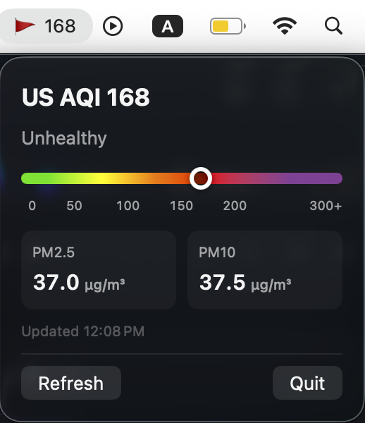

## AQI Monitor

A simple Swift-based toolbar application that displays information about the air quality in the users current location.

With all the haze and rapidly rising AQI stuff going on, thought this might be a useful little tool to have right on my toolbar instead of having to fight through websites.

This project uses [Open Meteo API Weather API](https://open-meteo.com) for all AQI information.